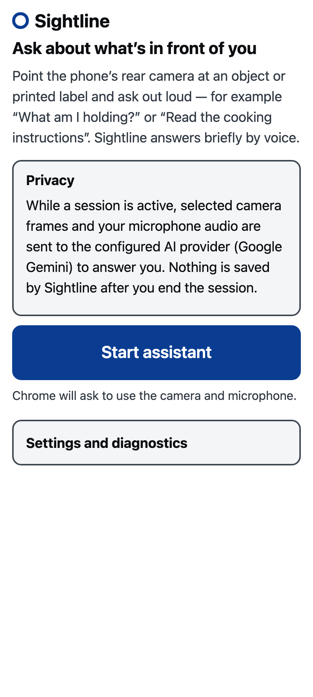
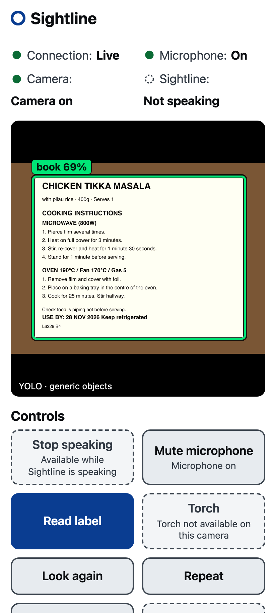
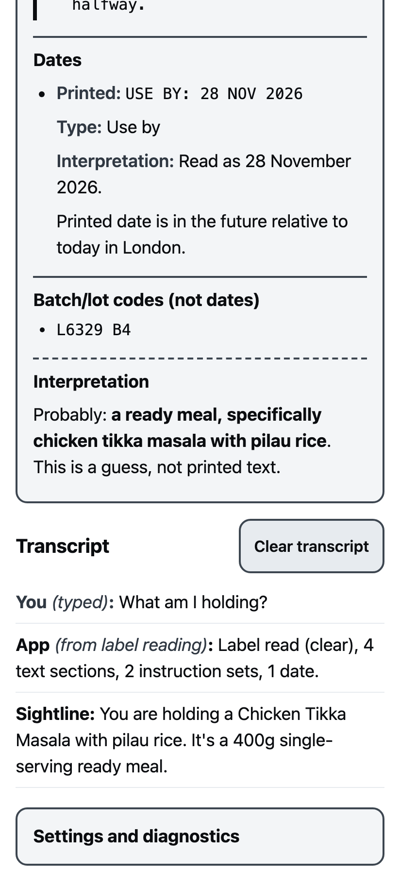
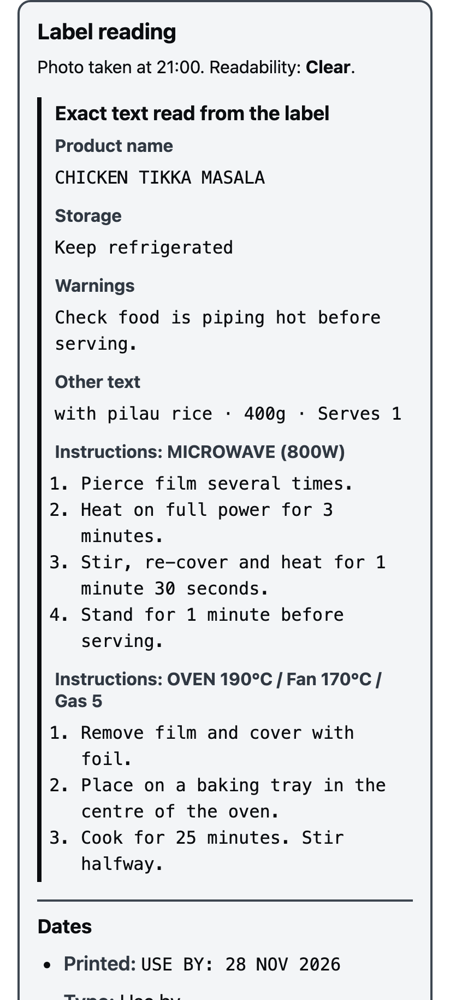
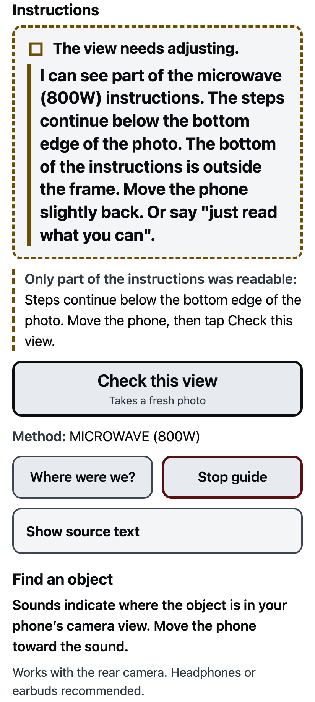
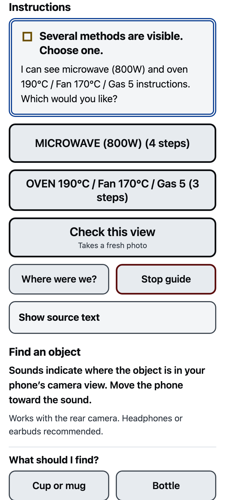
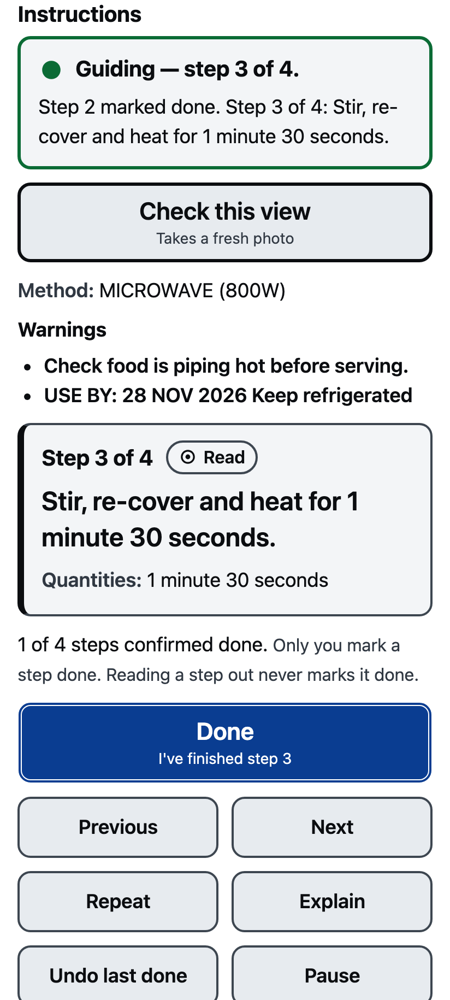
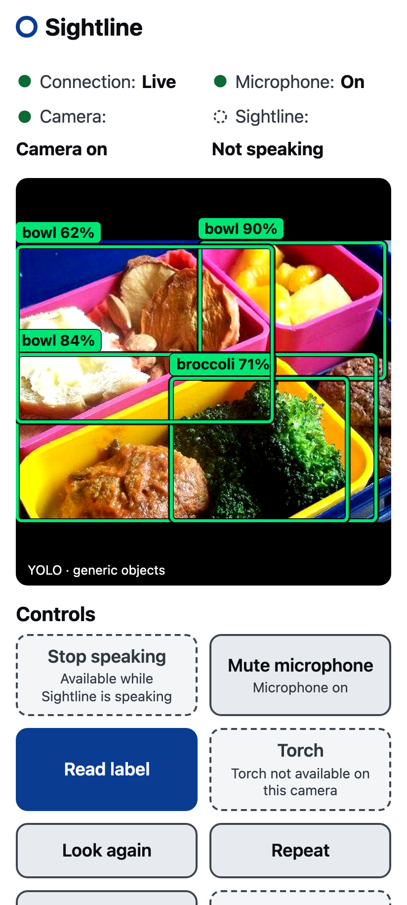
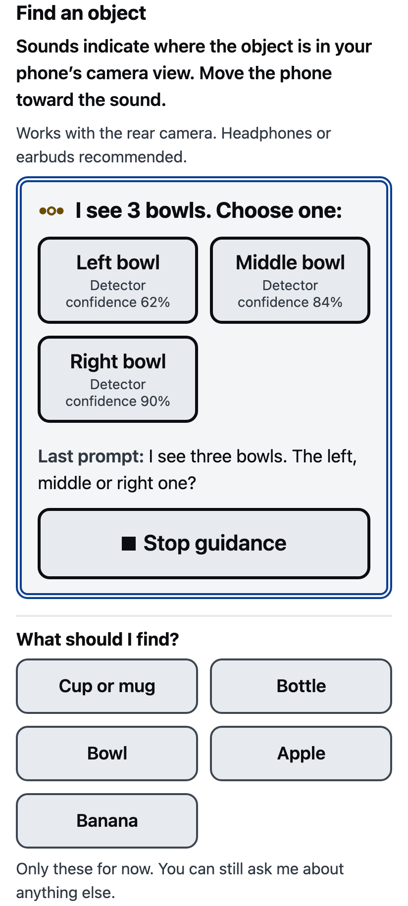
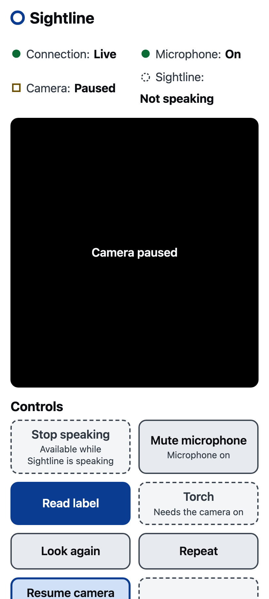

# How Sightline works: a walkthrough with screenshots

This walkthrough follows Sightline through its main features, one screen at a time. Each screen comes with what
the user does, what they hear, and what happens behind the scenes.

> **How these screenshots were made.** They come from the **real app** using the **real Gemini models** and the
> local YOLO detector. All the answers, label text and steps shown came from the live models in one run on
> 25 Nov 2026. The browser was desktop Chromium at a phone-sized viewport, not the S25 itself.
> - **Camera:** a generated video replaced the phone camera. It shows a **synthetic** packet I drew for testing
>   (not a real product) or a public COCO sample photo.
> - **Questions:** typed rather than spoken, because the fake microphone is silent.
> - **Reproduce:** `npx tsx scripts/capture-screenshots.ts` re-runs it. It uses API quota, and the wording changes
>   from run to run.

---

## 1. Start



The first screen says what the app does and **what leaves the phone**. While a session runs, camera frames and
microphone audio go to Google Gemini. Nothing is saved after the session ends.

Tapping **Start assistant** does three things in that one tap, because browsers only allow sound after a user
gesture:
- turns on the rear camera and the microphone;
- unlocks audio playback;
- opens a WebSocket to the Sightline server.

**Behind the scenes:**
- **Same origin.** The phone only ever talks to its own origin (`http://localhost:3000`, forwarded to the laptop
  over adb).
- **Key on the server.** The Gemini API key lives on the server and is never sent to the browser. Every build is
  scanned to check this.
- **Access gate.** Any non-local address is refused unless an access token is set.

<br clear="right">

---

## 2. A live conversation



Once connected, the status line reads **Connection: Live**. The user simply talks, and the camera preview shows
what Sightline sees.

**Behind the scenes:**
- **Microphone audio** is captured by an AudioWorklet as 16 kHz PCM. It streams continuously to the server, which
  forwards it to **Gemini Live** (`gemini-3.8-live`).
- **Camera frames** are sent at **at most one per second** (≤768 px JPEG). Only the newest frame is kept, so
  Gemini never sees a backlog of stale frames.
- **Replies** come back as 24 kHz audio, together with live transcripts.
- **Interrupting:** if the user starts talking, playback stops at once, and the rest of that turn is discarded on
  both server and phone.
- **Green boxes** come from the optional **local** YOLO26n detector, which runs on the laptop at about 5 frames a
  second. It sees small frames that never go to Gemini. Its labels are generic: here it calls the packet a
  "book". It never answers questions; Gemini does.

<br clear="right">

---

## 3. "What am I holding?"



The answer is short and spoken: *"You are holding a Chicken Tikka Masala with pilau rice. It's a 400g
single-serving ready meal."*

Gemini decided by itself that a packet needed a proper look. It called Sightline's `read_label` **tool** rather
than guessing from the 1-per-second video. You can see this in the transcript entry *"App (from label reading)"*.

**Behind the scenes:** the server asked the phone for a **fresh, full-resolution photo**, read it with the vision
pipeline in section 4, and returned the evidence to Gemini. Gemini then answered from that evidence.

The tools are a fixed list: read label, look again, find, and the guide controls. There's no web access and no
command execution.

<br clear="right">

---

## 4. Reading the label



The **Label reading** panel shows what the voice summary is based on.

**What the panel separates:**
- **Exact text read from the label**, verbatim: product name, storage, warnings, and the microwave and oven
  instructions kept as separate methods.
- **Interpretation**, which is the model's guess. It's labelled "This is a guess, not printed text."
- **Dates**, handled by **code, not the model** (`src/shared/dates.ts`). "USE BY: 28 NOV 2026" is recognised as a
  *use-by* date, read as 28 November 2026, and compared with today's date in London. Years are never invented,
  and "use by" is never confused with "best before".
- **Batch/lot codes**, such as `L6329 B4`, are listed separately and **never treated as dates**.

**Behind the scenes (small print):**
1. A fast model (`gemini-3.5-flash-lite`) finds the text regions in the full-resolution photo.
2. Those regions are cropped at native resolution.
3. The crops are read at Gemini's highest image detail.

In this run, the main vision model returned **503 (overloaded)**, so the read fell back to the fast model and took
about 22 seconds. When the provider is healthy it is much faster. The fallback is deliberate: a slow answer beats
no answer.

<br clear="right">

---

## 5. Instruction companion: getting a readable view



"**Guide me through these instructions**" starts the instruction companion. Here the camera was pointed too high,
so the steps ran off the bottom of the photo.

Sightline didn't guess at the missing steps. It gave **one** concrete adjustment that the photo justifies: *"The
bottom of the instructions is outside the frame. Move the phone slightly back."* The user can then ask "How about
now?", which **always takes a new photo**, or say "just read what you can".

**Behind the scenes:**
- The fresh photo goes to `extractGuide`. In this run that took about 5 seconds.
- The model reports how readable the view is and what's wrong with it, with evidence.
- For cut-off views the app uses fixed wording for the adjustment, so the advice can't contradict itself between
  tries.

**One problem this run exposed.** A second safeguard checks whether text touches the photo's edge, and it relies
on the fast text-region pass. In this run that pass returned 503 several times, so the edge check was skipped.
- On an earlier, milder framing, where only the last step's bottom half was cut off, the guide accepted the four
  microwave steps as complete.
- The screenshot here comes from a retry with a more clearly cut-off view, where the model itself reported the
  problem.
- This is a known limitation: when the provider is overloaded, cut-off detection is less reliable.

<br clear="right">

---

## 6. Choosing a method



With the whole packet in view, Sightline found **two methods** and asked which one the user wants: *"I can see
microwave (800W) and oven 190°C / Fan 170°C / Gas 5 instructions. Which would you like?"*

Methods are **never merged**. Mixing microwave and oven steps is exactly the kind of mistake that matters in a
kitchen.

<br clear="right">

---

## 7. Walking through the steps



The user chose Microwave. In this screenshot:
- They said **Next** at step 1. That moved on but did **not** mark step 1 done.
- They said **Done** at step 2, which marked step 2 done.
- They are now on step 3, and the panel shows **"1 of 4 steps confirmed done"**.

The panel always shows "Step X of Y", whether each step has been *read* or *confirmed done*, the method, and the
packet's warnings.

**How progress is handled:**
- **The app owns progress, not the model** (`src/server/guide/GuideMachine.ts`).
- Gemini interprets what the user says, but every change is validated by the app.
- A spoken **"Done" is checked against the user's actual transcribed words**, so "I'm not done yet" or "Do I say
  done?" never confirms a step.
- **Next ≠ Done.** Repeat, Explain ("what does *pierce* mean?") and Previous never change progress.
- **Undo** reverses the last Done. **Pause/Resume** and **"Where were we?"** keep the place.

**Text and numbers:**
- **Step text comes from the app**, and Gemini is told to read it verbatim.
- If the simplified spoken wording changes a number (3 minutes, 800W, 190°C), the printed text is used instead
  (`src/shared/guideChecks.ts`).

**Recovery:** the guide survives a dropped connection or a Gemini reconnect. After a full page reload the app says
honestly that the place was lost.

<br clear="right">

---

## 8. Object boxes



With the camera on a table of food, the local detector draws **green boxes** with labels and confidence, such as
"bowl 90%" and "broccoli 71%".

The boxes help sighted helpers and low-vision users see what the system sees. Screen-reader users get the same
information as a text summary.

<br clear="right">

---

## 9. Finding an object, with stereo sound



"**Find the bowl**" (or the Bowl button) starts Find mode. Here there are three bowls, so Sightline asks
*"I see three bowls. The left, middle or right one?"* rather than picking one silently.

Once the user chooses, a **stereo beacon** guides them:
- an object on the left of the picture beeps in the left ear, and one on the right beeps in the right;
- the pulses **speed up as it gets closer to the centre** of the picture;
- a chime and "Bowl centred in the camera" play when it is held steady in the middle.

**Behind the scenes:**
- A lightweight tracker keeps hold of the *chosen* bowl, so the sound doesn't jump between bowls.
- Observations older than 0.7 s are ignored.
- "Centred" uses hysteresis plus a 0.6 s dwell, so it doesn't flicker.

**Settings and limits:**
- A **stereo check** confirms the earbuds really play left and right.
- Spoken directions ("left", "up") are available for one-ear or mono listening.
- Supported items for now: cups and mugs, bottles, bowls, apples and bananas.
- The guidance is about the **camera picture**; it isn't a measure of distance.

<br clear="right">

---

## 10. Pause camera



**Pause camera** turns the camera completely off. The device is released and no frames are sent. The
conversation carries on by voice.

**What happens while paused:**
- Gemini is told it can't see, so it won't describe an old picture as if it were current.
- Read label, Find and Guide ask the user to tap **Resume camera** first.
- Switching apps and coming back doesn't turn the camera on by itself.

<br clear="right">

---

## The whole system on one page

```
 Phone (Chrome)                               Laptop: Node server (port 3000)                  Google / local
┌───────────────────────────┐  one origin   ┌──────────────────────────────────────────┐
│ React UI + controller     │  HTTP + WS    │ Access gate, origin check, zod validation │
│  mic 16 kHz PCM ──────────┼──────────────►│ ClientSession (one per user)              │
│  camera ≤1 FPS frames ────┼──────────────►│  ├─ LiveBridge ───────────────────────────┼──► Gemini Live (voice, frames, tools)
│  detect frames 5 FPS ─────┼──────────────►│  ├─ tools: read_label, look_again,        │
│  fresh hi-res stills ◄────┼── on request ─┤  │   find_object, guide tools              │
│  24 kHz audio playback ◄──┼───────────────┤  ├─ VisionService ────────────────────────┼──► Gemini Flash (labels, steps)
│  stereo beacon, earcons   │               │  ├─ dates.ts (code, not model)            │
│  transcript, panels       │               │  ├─ GuideMachine (app-owned progress)     │
└───────────────────────────┘               │  └─ DetectorService ──────────────────────┼──► local YOLO26n (127.0.0.1)
                                            └──────────────────────────────────────────┘
```

**The main idea.** The model handles what models are good at: understanding speech, describing scenes, and
reading text. The app handles what must be exact:
- which step you're on, and what counts as "done";
- what a date means;
- the exact step text and numbers;
- what is and isn't sent anywhere.

More detail is in [architecture.md](architecture.md); evidence is in [test-results.md](test-results.md).

## Honest limits

- **Not seen on the S25:** these screens came from desktop Chromium. On the S25, I've used the conversation and
  label reading. Find with earbuds and the instruction companion still need proper device testing.
- **Free-tier errors:** on the free tier, Gemini often returned 503 (overloaded) during this capture. Sightline
  reported it or fell back, but responses were slower, and cut-off detection was weaker (section 5).
- **No user testing yet:** it hasn't been tested with blind or low-vision users. That is the most important next
  step.
- **Assistance only:** Sightline reads and describes. It doesn't certify food safety, freshness or allergens.
